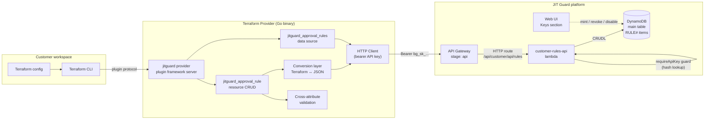
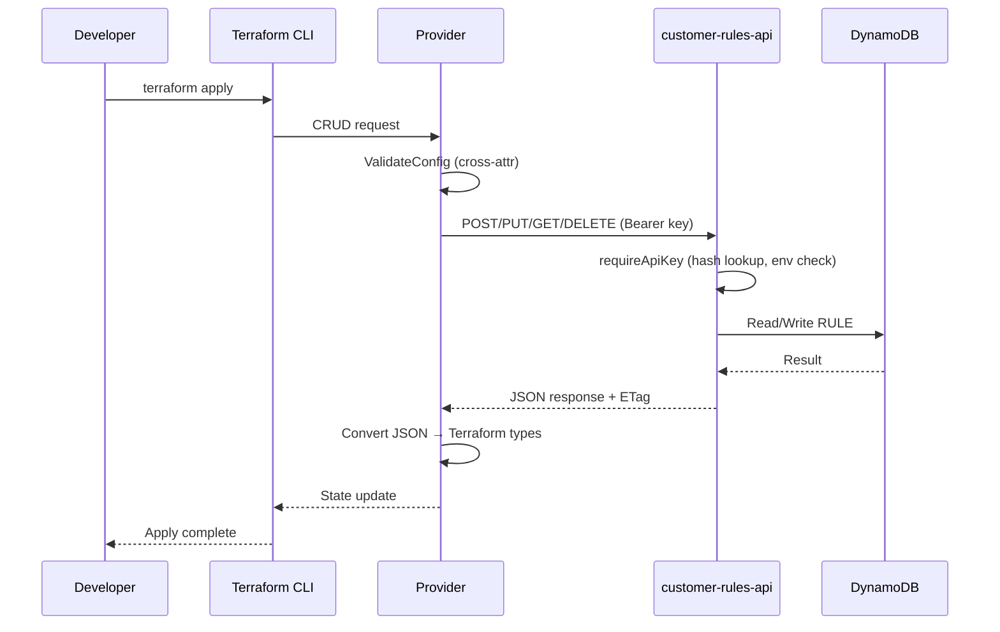

# Terraform Provider

The Terraform Provider lets customers manage JIT Guard approval rules as code, through a Go-based custom provider that talks to the API-key-secured machine API. Without it, approval rules can only be managed via the web UI; the provider enables version-controlled, auditable, reproducible rule definitions aligned with infrastructure-as-code practices.

The provider is distributed as a standalone Go binary, built on the Terraform Plugin Framework and plugin protocol v6. It is published on the Terraform Registry as `jitguard/jitguard`. Releases are signed GitHub Releases that the Registry ingests; `scripts/download-provider.sh` remains available for pre-release and offline installs.

## Boundaries

### What belongs here

- **Provider code**: the Terraform provider source — Go source, schemas, client, conversion logic
- **Provider resources**: `jitguard_approval_rule`, `jitguard_organization_settings`, `jitguard_integration_pagerduty`
- **Provider data sources**: `jitguard_approval_rules`, `jitguard_aws_connection`, `jitguard_integrations`
- **Provider config**: endpoint URL, API key, TLS skip-verify
- **Client layer**: HTTP client with bearer auth, request/response handling, error mapping
- **Distribution**: Terraform Registry, backed by signed GitHub Releases; the download script is a pre-release/offline fallback
- **Reference documentation**: generated via `tfplugindocs`

### What does NOT belong here

- The machine API lambdas (`customer-rules-api`, `customer-settings-api`, `comms-config-api`) — the provider is a *consumer* of those APIs
- API key minting or lifecycle management (`customer-api-keys` lambda, web UI Keys section) — keys are created by the customer outside the provider
- Approval rule evaluation logic (the rule engine in the backend domain) — the provider only defines rules, it never evaluates them
- AWS infrastructure resources — the provider configures JIT Guard, not AWS
- DynamoDB table design or access patterns — the provider is a pure HTTP client

## Architecture

### Provider lifecycle

The provider follows the standard Terraform plugin lifecycle:

1. **Init** — Terraform fetches the provider binary (from the filesystem mirror), starts the plugin process, and negotiates the protocol version.
2. **Configure** — Terraform reads the provider block (`endpoint`, `api_key`, `skip_verify`), resolves the API key from config or environment variable, and constructs the shared HTTP client.
3. **Plan** — For each resource/data source, the provider reads the current remote state (GET from the machine API) and compares it to the desired state in HCL. Cross-attribute validation runs before any API call.
4. **Apply** — Creates, updates, or deletes resources via the machine API. Updates use full replacement with `If-Match` optimistic concurrency.
5. **Refresh** — Periodically re-reads remote state to detect drift from external changes.

### Machine API path

The provider appends one of three API-key machine paths to the configured endpoint:

- `/api/customer/api/rules` — approval-rule CRUDL
- `/api/customer/api/settings` — organization settings and AWS connection facts
- `/api/customer/api/integrations` — Slack/PagerDuty status and PagerDuty writes

The `api` segment is the API Gateway stage name; `/customer/api/...` is the gateway route. These paths are distinct from the web UI's `/customer/...` routes (which use JWT authentication), keeping the two auth models separate and testable. `customer-settings-api` and `comms-config-api` are separate Lambdas from the JWT handlers, each validating the API key itself.

## Key Abstractions

### Provider configuration

Three attributes configure every JIT Guard provider instance:

- **`endpoint`** (required) — the API base URL, allowing any environment (production, staging, local) to be targeted. This is the origin only; the provider appends the machine API paths.
- **`api_key`** (optional, sensitive) — a `bg_sk_live_...` key minted in the web app. Falls back to the `JITGUARD_API_KEY` environment variable. Only a hash is stored server-side; a lost key must be revoked and re-created. The key format follows the `apikeys.guide` convention: `bg_sk_live_<secret>_<checksum>` with 256 bits of entropy.
- **`skip_verify`** (optional) — disables TLS certificate verification for local testing against self-signed endpoints.

During `Configure`, the provider constructs an HTTP client with the resolved endpoint, API key, and TLS settings. This client is shared by all resources and data sources. The client sets a `User-Agent` header (`jitguard-terraform-provider/<version>`) for server-side telemetry.

### `jitguard_approval_rule` resource

The primary resource. Full CRUD lifecycle plus `terraform import` by rule ID.

Key attributes:
- **`rule_id`** — server-assigned, immutable, computed. Used as the import identifier.
- **`name`** — human-readable identifier. Required on create.
- **`description`** — free-form text. Defaults to empty string.
- **`enabled`** — toggles whether the rule is active. Defaults to `true`.
- **`auto_approve`** — `true` grants matching requests immediately; `false` requires approval from configured groups. Required on create.
- **`sso_group_ids`** — SSO groups whose members may request access under this rule. Required.
- **`approver_group_ids`** — groups that can approve when `auto_approve = false`. Required when approval is needed.
- **`oncall_approval`** — auto-approve requesters who are currently on-call. Defaults to `true`. Only applies when `auto_approve = false`.
- **`accounts`** — nested block defining which AWS accounts/OUs/tags the rule applies to.
- **`permission_sets`** — nested block defining which SSO permission sets the rule applies to.
- **`created_at`** / **`updated_at`** — server-managed timestamps. `updated_at` doubles as the ETag.

Updates are full replacements, not patches. The entire rule object is sent on every `Update`.

### Account conditions

Each `accounts` block defines a matching condition with a type discriminator:

| Type | Required fields | Description |
|------|----------------|-------------|
| `account_id` | `account_id` | Matches a specific 12-digit AWS account ID |
| `account_tag` | `tag_key`, `tag_value` | Matches accounts with a specific tag key-value pair |
| `ou_descendant` | `ou_id` | Matches all accounts descending from an AWS OU (`ou-...` format) |

A rule can have multiple `accounts` blocks; a request matches if it targets any of the listed accounts/OUs.

### Permission set conditions

Each `permission_sets` block defines a matching condition:

| Type | Required fields | Description |
|------|----------------|-------------|
| `permission_set_arn` | `arn` | Matches a specific SSO permission set ARN, or `"*"` for any |
| `permission_set_tag` | `tag_key`, `tag_value` | Matches permission sets with a specific tag |

### `jitguard_approval_rules` data source

Returns a list of all approval rules for the customer. Useful for discovering existing rules before adopting them into Terraform state. The data source paginates through all server-side pages automatically (cursor-based pagination) and returns the full list.

### `jitguard_organization_settings` resource

A singleton resource over the same settings object the web app edits:

- `name`, `approval_expiry_hours`
- one `PUT` per apply, sending only the attributes configured in HCL
- import with the fixed ID `settings`
- delete is a no-op on the server (the settings object cannot be deleted); Terraform drops it from state

### `jitguard_integration_pagerduty` resource

PagerDuty is the only integration the machine API can write. The key is a
write-only Terraform attribute: it is sent on apply but never stored in state
or plan. `api_key_version` is the rotation trigger. Deleting the resource
disconnects PagerDuty. Slack is OAuth-installed and read-only.

### `jitguard_aws_connection` and `jitguard_integrations` data sources

`jitguard_aws_connection` exposes JIT Guard's connection facts (status,
management account, SSO region/instance) without pretending to own AWS
accounts, OUs, permission sets or groups. `jitguard_integrations` exposes Slack
and PagerDuty status; the PagerDuty key is only ever returned masked.

### Optimistic concurrency model

The provider uses `If-Match`/ETag headers for update and delete operations:

1. On `Read`, the provider stores `updated_at` (or `created_at` as fallback) in state as the version identifier.
2. On `Update` or `Delete`, it sends `If-Match: "<timestamp>"` to the API.
3. If the rule was modified on the server since the last read, the API returns `412 Precondition Failed` and Terraform fails the apply with a clear error message instructing the user to re-plan.
4. If the rule was deleted concurrently, the provider gracefully removes it from state (returns nil without error).
5. Missing `If-Match` on the server side returns `428 Precondition Required`, treated as an internal provider bug.

This prevents silent overwrites from concurrent edits (e.g., someone editing the same rule in the web UI while Terraform runs).

### Conversion layer

The conversion layer translates between the Terraform Plugin Framework's `types.Set` / `types.Object` model and the machine API's JSON contract. It handles:

- String set encoding/decoding (`types.Set` ↔ `[]string`)
- Account condition nested objects (type discriminator + conditional fields, where only the relevant fields are set per type)
- Permission set condition nested objects (similar type-discriminated pattern)
- Null-vs-empty normalization — the API omits unset fields (decode to `""`), but the Terraform plan has `null` for them; the conversion normalizes empty strings to null to keep plan and state consistent

### Validation

Cross-attribute validation via `ValidateConfig` rejects a `requires-approval` rule (i.e., `auto_approve = false`) that has no `approver_group_ids` before any API call is made. This mirrors the machine API's own validation and produces a clear diagnostic at plan time, preventing wasted API calls.

### HTTP client

The API client layer provides:

- Bearer token authentication (`Authorization: Bearer <api_key>`)
- JSON request/response serialization
- Structured error handling — API errors are decoded into an `APIError` type with status code, error code, message, and optional field reference
- Configurable timeout (30 seconds default)
- Optional TLS skip-verify for local testing
- Paginated list traversal (cursor-based, opaque base64url cursors)

## Integration Points

### Upstream (who calls this)

- **Terraform CLI** — executes the provider binary via the plugin protocol (gRPC over stdio)
- **CI/CD pipelines** — run `terraform plan`/`apply` as part of infrastructure-as-code workflows
- **Developers** — write HCL configuration files defining approval rules

### Downstream (what this calls)

- **customer-rules-api lambda** — `/api/customer/api/rules`, API-key authenticated CRUDL for approval rules.
- **customer-settings-api lambda** — `/api/customer/api/settings`, API-key authenticated settings read/write.
- **comms-config-api lambda** — `/api/customer/api/integrations`, API-key authenticated Slack/PagerDuty status and PagerDuty writes.
- **DynamoDB main table** — the machine APIs read/write `RULE#`, settings and integration records; the provider never touches DynamoDB directly
- **DynamoDB customer_audit table** — all machine mutations are audited by the owning Lambda with an `actorType: 'service'` shape

### External systems

- **GitHub Releases** — every release carries the per-platform zips, the Registry manifest, `SHA256SUMS`, and its GPG signature (`SHA256SUMS.sig`). Customers normally install via `terraform init`; `scripts/download-provider.sh` verifies the checksum and installs into Terraform's implicit filesystem mirror for pre-release/offline use.
- **Terraform Registry** — the public provider is `jitguard/jitguard`. The Registry validates the manifest (`protocol_versions: ["6.0"]`) and the GPG signature, then ingests the release when the draft is published.

## Invariants

- **API key scoping**: each API key is scoped to a single customer; the provider can only manage rules for the customer that minted the key. There is no cross-customer access.
- **Settings are singleton and partial**: one settings object per customer; every apply sends only the attributes configured in HCL, so a field the resource does not manage is left untouched. The settings resource has no server-side delete.
- **PagerDuty key is write-only**: Terraform never stores the PagerDuty API key in state or plan. `api_key_version` is the rotation trigger; the API only returns a masked key.
- **Slack is OAuth-only**: the machine API can read Slack status but cannot install, connect or disconnect it. Those remain web-app actions.
- **Full replacement updates**: every `Update` sends the complete rule object, not a diff. The server replaces the entire rule, preserving `createdAt` and bumping `updatedAt`.
- **Optimistic concurrency**: all mutations require a valid `If-Match` header. Stale or missing headers fail the request (412 or 428). The provider always reads before writing.
- **No state drift detection**: the provider does not detect drift beyond what Terraform's refresh cycle provides. If a rule is modified outside Terraform (web UI, direct API call), the next plan will show a diff.
- **Rate limiting**: the machine API enforces per-customer rate limits (default 120 requests/60s). Exceeding returns 429 with `Retry-After`. The provider does not implement client-side backoff.
- **Key immutability**: the API key is used as-is on every request. If the key is revoked server-side, all subsequent provider operations fail with 401.
- **Validation-before-apply**: the provider performs cross-attribute validation (e.g., approver groups required when approval is needed) at plan time, before any API call is made.
- **Idempotent reads**: `GET` operations are safe to retry. The provider's `Read` method always re-fetches the current state from the server.

## Testing

The provider ships two tiers of tests:

- **Unit tests** (`go test`) — test the HTTP client layer, error mapping, and conversion logic against an in-process `httptest` fake. No credentials or network required.
- **Framework acceptance tests** — run the real Terraform plugin protocol against an in-process fake of the machine API, covering create/update/import/data-source/delete flows. These require the `TF_ACC` environment variable; CI sets it, so a regression cannot hide behind a skipped test.

For end-to-end validation, developers can run `terraform plan`/`apply` against a real environment with a minted API key.

## Distribution

The provider is published to the Terraform Registry from signed GitHub Releases:

1. **Version** — merging a Conventional-Commit PR to `main` runs `semantic-release`, which computes the next SemVer version from the commits, generates the release notes, and pushes the tag. The `next` branch produces prereleases.
2. **Build** — GoReleaser builds per-platform zip archives (linux/darwin/windows × amd64/arm64), the `terraform-registry-manifest.json` release asset, and `SHA256SUMS`; it signs the checksums with the prod signing key from SSM.
3. **Draft + publish** — `semantic-release` creates a draft GitHub Release, uploads every signed asset, and then publishes it, so the Registry webhook only fires once the release is complete.
4. **Install** — customers run `terraform init`; `scripts/download-provider.sh` remains the pre-release/offline fallback.
5. **Docs** — `tfplugindocs` generates the reference documentation from the provider schema into `docs/`.

The signing key lives in the prod-only SSM parameter
`/jitguard/prod/terraform-provider-jitguard/gpg-signing-key`, created by
`jitguard-core` as a `placeholder` with `ignore_changes = [value]` and
`prevent_destroy`, then populated out-of-band. The Terraform Registry must
have the matching public key registered before the first release.

## Related Decisions

- [ADR-0015](https://github.com/JITGuard/jit-guard/blob/main/docs/adr/0015-customer-api-keys-and-rules-provider.md) — customer API keys, rules CRUDL endpoints, and Terraform provider (the foundational decision for this domain)
- [ADR-0010](https://github.com/JITGuard/jit-guard/blob/main/docs/adr/0010-approval-rules-engine.md) — the rule engine data model that the provider's rules conform to (`RULE#` items on the main table)
